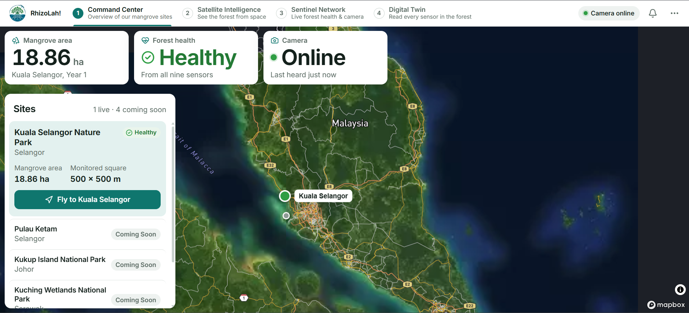
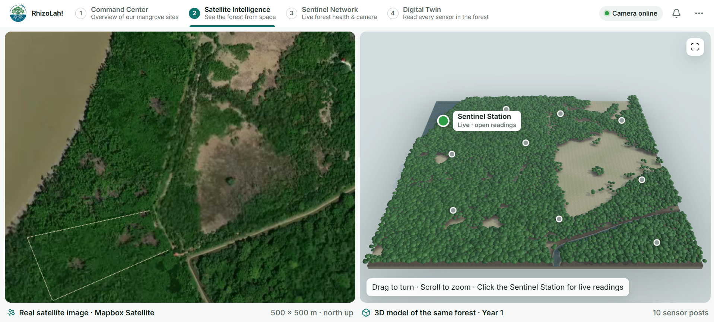
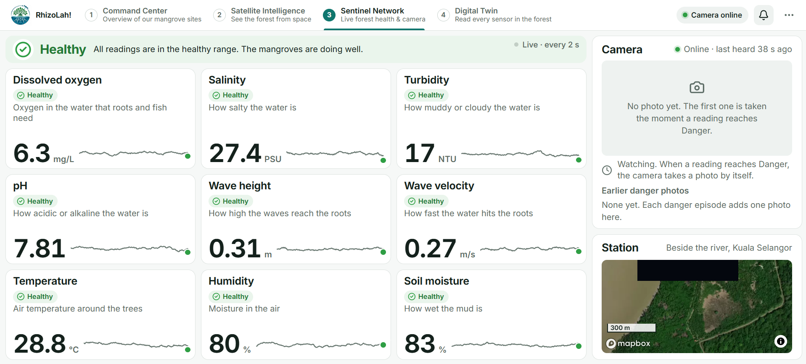
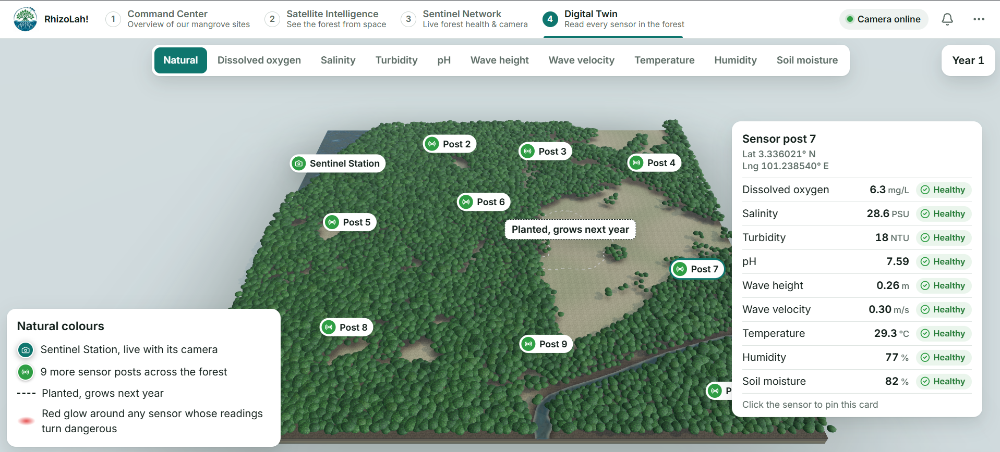

# RhizoLah! | Blue Carbon Sentinel

A browser-based demonstration of mangrove monitoring at Kuala Selangor Nature Park, Malaysia. Explore the site on a satellite map, compare it with a 3D forest, follow environmental readings, and try danger detection and replanting scenarios.

This repository contains a frontend demo built with React, TypeScript and Vite. Sensor readings, camera activity, replanting scans and the text labelled "AI" are simulated or generated locally. Satellite imagery comes from Mapbox. You do not need a backend, database, AI API key or connected ESP32 board to run it.

- [Product overview](#product-overview)
- [Set up the project](#set-up-the-project)
- [Start it again on Windows](#start-it-again-on-windows)
- [Try the demo](#try-the-demo)
- [Use your own camera photos](#use-your-own-camera-photos)
- [Development and build commands](#development-and-build-commands)
- [Project structure](#project-structure)
- [Troubleshooting](#troubleshooting)

## Product overview

The four pages follow the same forest through different views. The monitored square is 500 × 500 m (25 hectares), with ten sensor posts: the Sentinel Station and nine additional posts. Each reading contains nine environmental measurements. The interface uses the RhizoLah! name.

### 1. Command Center

See the Malaysian site catalogue, mangrove area, forest health and camera status. Kuala Selangor is the active demo site; four other sites are marked "Coming Soon". Select **Fly to Kuala Selangor** to move into the site and open Satellite Intelligence.



### 2. Satellite Intelligence

Compare Mapbox satellite imagery on the left with a 3D model of the same forest on the right. The model uses stored canopy and water outlines. Drag to rotate the model, scroll to zoom, and select the Sentinel Station to open its readings in Sentinel Network.



### 3. Sentinel Network

Follow nine measurements updated every two seconds: dissolved oxygen, salinity, turbidity, pH, wave height, wave velocity, temperature, humidity and soil moisture. Each card shows a value, trend and health status. The camera panel displays a photo after a simulated danger event, and the station map shows its location.



### 4. Digital Twin

Explore the 3D forest in natural colours or select a measurement layer. Hover over a sensor post to see its coordinates and all nine readings; click the post to pin the card. Planted patches have dashed outlines. Monitoring stays at Year 1 in this demo.



## Set up the project

Complete these steps once. All terminal commands below run from the project folder, which contains `package.json`, unless a step says otherwise.

### Step 1: Install the prerequisites

You need:

| Requirement | What to install or prepare |
| --- | --- |
| Node.js and npm | Install a current LTS release from [Node.js](https://nodejs.org/en/download). npm comes with Node.js. The locked Vite dependencies require Node.js 20.19 or newer within the 20.x series, or Node.js 22.12 or newer. |
| Browser | A current desktop browser with WebGL support. Chrome or Edge with graphics acceleration enabled is a suitable starting point. |
| Internet connection | Required to install dependencies and load Mapbox maps and satellite imagery. |
| Mapbox account and public token | Required for the maps. Step 3 explains how to configure it. |
| Git, if cloning | Install [Git](https://git-scm.com/downloads), or use the ZIP download in Step 2. |

After installing Node.js, open a **new** terminal. On Windows, use PowerShell, Command Prompt or the terminal in VS Code. Check both commands:

```sh
node --version
npm --version
```

Both commands should print a version number. If either command is unrecognised, restart the terminal and check that Node.js was added to your system's PATH during installation.

### Step 2: Download the project and open its folder

If you use Git, run these commands from the directory where you keep projects:

```sh
git clone https://github.com/ShawnLYZ/Blue-Carbon-Sentinel.git
cd Blue-Carbon-Sentinel
```

Alternatively, open the [GitHub repository](https://github.com/ShawnLYZ/Blue-Carbon-Sentinel), select **Code → Download ZIP**, and extract the ZIP. Open a terminal in the extracted folder containing `package.json`. The folder may be named `Blue-Carbon-Sentinel-main`.

On Windows, you can open that folder in File Explorer, click the address bar, type `powershell`, and press Enter. You can also change directory manually, replacing this example with your actual folder:

```powershell
cd "C:\path\to\Blue-Carbon-Sentinel"
```

### Step 3: Configure the Mapbox token

1. Sign in to [Mapbox](https://console.mapbox.com/) or create an account.
2. Open the [Access tokens page](https://console.mapbox.com/account/access-tokens/). Copy your default public token for local development, or create a public token for this project. Public tokens begin with `pk.`. See [Mapbox's token guide](https://docs.mapbox.com/help/dive-deeper/access-tokens/) for the account steps.
3. In the project folder, make a copy of `.env.example` named `.env.local`. If `.env.local` already exists, edit it instead of overwriting it.

   Windows PowerShell:

   ```powershell
   Copy-Item .env.example .env.local
   notepad .env.local
   ```

   macOS or Linux:

   ```sh
   cp .env.example .env.local
   ```

   Then open `.env.local` in a text editor.

4. Replace the empty value with your public token and save the file:

   ```dotenv
   VITE_MAPBOX_TOKEN=pk.paste_your_public_token_here
   ```

   Replace the whole example value with the token you copied. Keep the variable name exactly as shown. The file must be named `.env.local`, not `.env.local.txt`, and sit beside `package.json`.

5. If your token has URL restrictions, allow the local address you will use, normally `http://localhost:5173`. Include any other address or port you use for this project. Mapbox explains [URL restrictions](https://docs.mapbox.com/accounts/guides/tokens/#url-restrictions) in its account documentation.

Use a public token for this browser application. Vite includes `VITE_` values in the client bundle, so do not put a secret Mapbox token or other credentials there. `.env.local` is ignored by Git.

The sensors and 3D demo can run without a token, but the map panels will show "Satellite image unavailable". After changing `.env.local`, stop and restart the development server. Rebuild if you are using a production build.

### Step 4: Install dependencies

Run:

```sh
npm ci
```

This installs the dependency versions recorded in `package-lock.json` into `node_modules`. Wait until the command finishes successfully and the terminal prompt returns. You only need to install again when dependencies change or `node_modules` is removed.

If PowerShell reports that `npm.ps1` cannot be loaded, use `npm.cmd ci` instead. The same substitution works for the other npm commands in this guide.

### Step 5: Start the development server

Run:

```sh
npm run dev
```

Vite starts at [http://localhost:5173](http://localhost:5173) and opens your browser automatically. If no tab opens, open that address yourself. The initial page is Command Center, normally at [http://localhost:5173/#/command](http://localhost:5173/#/command).

Keep the terminal running while you use the demo. Do not open `index.html` directly from File Explorer; the project needs Vite to process its source files and camera photo list.

To stop the server, focus its terminal and press **Ctrl+C**. If Command Prompt asks whether to terminate the batch job, enter `Y`.

### Step 6: Confirm the setup works

1. Check that Command Center opens with the site list and the Kuala Selangor marker on a satellite map. A missing map usually points to the token or internet connection.
2. Open Satellite Intelligence and wait for the 3D forest to load. Drag the model and scroll to check rotation and zoom.
3. Open Sentinel Network and watch the readings update every two seconds. An empty camera panel is normal before the first danger event.
4. Open Digital Twin and hover over a sensor post. Its reading card should appear.

If you have used this browser for the demo before, it may restore an earlier danger event or planted patches. Use **⋯ → Reset demo → Reset** to return to healthy readings and unplanted patches.

## Start it again on Windows

After Node.js is installed, the project is extracted and `.env.local` is configured, you can launch the demo by double-clicking **`start.cmd`** in File Explorer.

The launcher switches to the correct folder, checks for Node.js, runs `npm install` if `node_modules` does not exist, checks that port 5173 is free, and starts the development server. Keep its window open; close it to stop the demo.

If `node_modules` already exists, the launcher skips installation. After pulling dependency changes, run `npm ci` manually before launching again.

On macOS or Linux, use `npm run dev` from the project folder.

## Try the demo

Use the navigation tabs or press **1**, **2**, **3** or **4** to move between pages. The demo controls are in the **⋯** menu at the top right, beside the notification bell.

### Explore the site

1. In Command Center, select **Fly to Kuala Selangor**.
2. In Satellite Intelligence, compare the satellite view with the 3D canopy. Drag to turn, scroll to zoom, or double-click the forest to move closer.
3. Select the **Sentinel Station** marker in the 3D view to open Sentinel Network.
4. In Digital Twin, choose a measurement layer, hover over a sensor post, and click it to pin its reading card. Press **Esc** or click the forest to release the card.

### Simulate danger and a camera response

1. Open Sentinel Network so you can watch the sensor cards and camera panel.
2. Open **⋯ → Simulate danger**.
3. Watch the readings move from Healthy through Warning to Danger over about ten seconds.
4. When a reading enters Danger, the demo requests a camera photo automatically. A photo normally arrives about 6 to 12 seconds after the request. One danger episode triggers one automatic photo.
5. Select the photo to open it full size. The default images are labelled **Sample photo**.
6. Choose **⋯ → Restore healthy** after the danger transition finishes. The readings return to Healthy over about ten seconds, and the photo history remains available.

The camera panel also has a **Save Lah!** action when its generated warning or danger summary appears. That action clears the displayed photo history and restores healthy readings. Use **Restore healthy** when you want to keep the photos.

### Run a replanting scan

1. Wait until all readings are Healthy and the recovery transition has finished.
2. Select **⋯ → Scan for replanting**. The app opens Sentinel Network and the scan overlay.
3. Wait about four seconds for the scan and another two seconds for its sample photo. Review the selected empty patch, local readings and approximate seedling count.
4. Select **Plant Lah!** once it is enabled to close the result and show the notification. The demo records the selected patch when the scan finishes.
5. Open Digital Twin to see the patch outlined and labelled "Planted, grows next year".

There are three predefined patches. After they have all been used, a scan reports that no suitable empty area was found. Use **Reset demo** to make the patches available again. The year stays at 1, so newly planted trees do not advance to a later growth year.

### Reset between demonstrations

Select **⋯ → Reset demo**, then confirm with **Reset**. This restores Healthy readings, resets the year to 1 and clears plantings. Camera photos and their history are kept.

Danger events, photo history and planted patches are stored in this browser's local storage under `bcs-demo-state-v1`. Reloading normally preserves them. A different browser, private window or local address has separate storage. Clearing site data removes the saved demo history.

## Use your own camera photos

The simulated danger camera uses the four bundled mangrove photos in `public/sample-photos` by default. Their credits and licences are recorded in [SOURCES.md](public/sample-photos/SOURCES.md) and shown when a sample photo is opened full size.

To replace the danger camera's sample library:

1. Save your camera images directly into the top-level `camera-photos` folder. Supported extensions are `.jpg`, `.jpeg`, `.png` and `.webp`. Files in subfolders are not included.
2. Name them in the order you want them used, for example `01-river.jpg`, `02-roots.jpg` and `03-canopy.jpg`. The demo sorts filenames and cycles through the images.
3. While the development server is running, adding or removing an image reloads the page automatically. Replacing the contents of an existing file may require a server restart and browser reload.
4. Trigger a new danger event to see a photo from the new library. Existing photo history still refers to the earlier images until it is cleared.

If `camera-photos` contains at least one supported image, those files replace the bundled danger photos and appear with the **ESP32-CAM photo** label. Adding files does not connect a live camera or upload endpoint. Removing all custom images switches new captures back to the bundled samples.

The replanting scan uses its own fixed sample image at `public/scan-photos/empty-area.jpg`; changing `camera-photos` does not replace that image. If neither custom nor bundled danger photos exist, requests fail and the panel offers **Try again**. Add an image before retrying.

For a production build, add your photos **before** running `npm run build`. They are copied into `dist/camera-photos`; changes to the source folder require another build.

## Development and build commands

Run these commands from the project root:

| Command | Purpose |
| --- | --- |
| `npm ci` | Install the versions in the lockfile. |
| `npm run dev` | Start Vite on port 5173, open the browser and reload on source changes. |
| `npm run typecheck` | Check TypeScript types without producing build files. |
| `npm run build` | Create the static production files in `dist`. |
| `npm run preview` | Serve the existing `dist` build locally on port 5173 and open the browser. |

To validate and preview a build:

```sh
npm run typecheck
npm run build
npm run preview
```

Stop the development server first because preview uses the same port. Preview does not rebuild the app; rerun `npm run build` after source, photo or environment changes. The Mapbox token is embedded at build time, and the finished app still needs internet access for maps. Serve `dist` through a web server instead of opening its HTML file directly.

The stack is React for the interface, Mapbox GL JS for maps, three.js for the forest, and Zustand for shared browser state. The forest model is generated in a Web Worker. No automated test script is currently defined in `package.json`; type checking and building are the available project checks.

## Project structure

```text
Blue-Carbon-Sentinel/
├── README.md                   # Overview and setup guide
├── .env.example                # Template for the Mapbox configuration
├── camera-photos/              # Optional custom danger camera images
├── docs/images/                # Product overview screenshots
├── public/
│   ├── brand/                  # RhizoLah! brand image
│   ├── sample-photos/          # Default danger camera photos and credits
│   └── scan-photos/            # Replanting scan sample photo
├── src/
│   ├── app/                   # App shell, navigation and top menu
│   ├── forest/                # 3D scene, model generation and worker
│   ├── geo/                   # Coordinates and monitored square
│   ├── maps/                  # Mapbox setup, globe and site maps
│   ├── pages/                 # Command, satellite, network and twin pages
│   ├── sim/                   # Sensor simulation, ranges and generated insights
│   ├── site/                  # Sites, sensor posts and traced canopy outlines
│   ├── state/                 # Shared state, camera simulation and persistence
│   ├── styles/                # Interface styles
│   └── ui/                    # Reusable controls, hooks and time formatting
├── package.json               # Dependencies and npm commands
├── package-lock.json          # Locked dependency versions
├── start.cmd                  # Windows launcher
└── vite.config.ts             # Vite setup and camera photo handling
```

For changes to sensor bands, start with `src/sim/ranges.ts`. Simulation timing is in `src/sim/engine.ts`, and camera behavior and persistence are in `src/state/store.ts`. Site and sensor positions are in `src/site/catalogue.ts`; traced forest and patch outlines are in `src/site/canopyOutlines.ts`.

## Troubleshooting

| Problem | What to check or do |
| --- | --- |
| `node` or `npm` is not recognised | Install Node.js, then reopen the terminal. Confirm that `node --version` and `npm --version` work. |
| PowerShell says `npm.ps1` cannot be loaded | Use `npm.cmd` in place of `npm`, for example `npm.cmd run dev`, or use Command Prompt. |
| npm reports an unsupported Node.js engine | Check `node --version` against Step 1. Install a compatible LTS release, reopen the terminal and run `npm ci` again. |
| npm cannot find `package.json` | Change into the extracted project root. With ZIP downloads, check whether you are one folder above the directory containing `package.json`. |
| Dependency installation fails | Check your internet connection and npm's error message. After resolving the reported issue, rerun `npm ci`. |
| Port 5173 is already in use | Stop the other server using that port, then try again. The project's strict port setting prevents an automatic switch. For a separate port, use `npm run dev -- --port 5174` and allow that address in your Mapbox token restrictions. |
| The browser did not open | Open the local URL printed by Vite, normally [http://localhost:5173](http://localhost:5173). Keep the server terminal open. |
| "Satellite image unavailable" | Check your connection, the public token, the exact `VITE_MAPBOX_TOKEN` name and the location of `.env.local`. Check allowed URLs if the token is restricted. Restart Vite after editing the file. |
| The token seems correct but maps still fail | Check the browser console and network panel for Mapbox errors. A rejected token, blocked request or account access issue must be resolved before imagery can load. |
| The 3D view is unavailable or slow | Enable browser graphics acceleration, restart the browser and close other GPU-heavy tabs. The model also lowers quality automatically when performance drops. |
| The camera says online but shows no photo | "Online" is a simulated heartbeat. A new photo is requested when a reading first enters Danger; wait for that request to finish. |
| Old danger values or planted patches return after reload | Saved browser state is being restored. Use **⋯ → Reset demo → Reset**. This keeps photo history. |
| Scan for replanting is disabled | Wait for all readings to become Healthy and for any danger or recovery transition to finish. |
| The scan cannot find another patch | All three predefined patches may already be planted. Reset the demo before trying again. |
| Custom photos do not appear | Check the folder and extension, trigger a new danger event, and inspect the latest photo. For preview builds, rebuild first. |

Satellite imagery is requested from Mapbox at runtime. The repository stores traced outlines used by the forest model; retain Mapbox's logo and attribution on the maps. Camera and scan photo licences are listed in [the photo source file](public/sample-photos/SOURCES.md).
