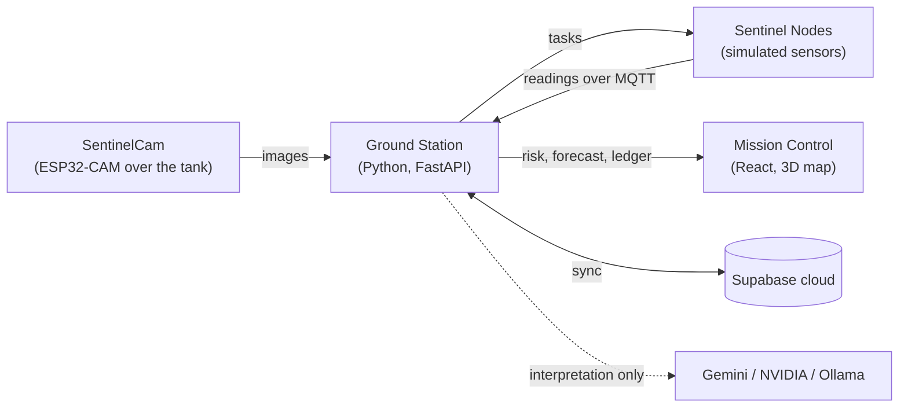

# Blue Carbon Sentinel

**Mangrove project intelligence using satellite observations, environmental modelling and carbon assessment history.**

Built for mangrove farm owners, carbon credit buyers, investors and partners. The prototype combines an open
satellite preview with the original Ground Station and simulated sensor workflows. Sentinel Nodes are fixed,
anchored monitoring units.

**Contents:** [About the project](#about-the-project) · [Website pages](#website-pages) ·
[Satellite dataset](#satellite-dataset) · [Requirements](#requirements) · [Setup](#setup)
(step-by-step for beginners) · [Start](#start) · [Where every key goes](#where-every-key-goes-quick-reference) ·
[Troubleshooting](#troubleshooting) · [For developers](#for-developers)

---

## About the project

### The problem

Mangrove forests are among the best natural carbon stores on Earth. The carbon they lock away in their trees and
mud is called **blue carbon**. Malaysia's coastline is losing mangroves, and replanting often fails.

Satellites can see the forest canopy shrinking from space, but they cannot see what is happening under the water
and in the mud: microplastics, the amount of oxygen in the water, how salty the soil is. Those conditions decide
whether a young sapling survives. Monitoring today is also passive: someone looks at a map after the damage is
done.

### The idea

The project aims to connect monitoring and project assessment in a **closed loop**:

1. **Observe the site.** Open Sentinel-2 imagery provides a dated view of the landscape and vegetation signals.
2. **Inspect conditions.** Ground Station and simulated node workflows provide a path to water and soil context.
3. **Explore the Digital Twin.** Users inspect a procedural 3D landscape, attribute overlays and scenario stress.
4. **Request an assessment.** A farm-wide validation request captures the current overview and covers every section.
5. **Review potential and changes.** Reports distinguish unclaimed creditable coverage, prior claims and exclusions,
   while retained snapshots support comparison over time.

Independent field validation, connected external verification and registry issuance remain separate from the
current demonstration. The app does not certify carbon credits or execute real market sales.

### What this prototype does

The original hackathon workflow uses a **tank model** and Ground Station. The updated website also provides
real open satellite observations and browser-local modelling/report simulations:

| Challenge goal | How this project does it |
|---|---|
| Observations and data engine | The **Ground Station** (Python + FastAPI) supports camera NDVI-proxy, backend risk, forecast and hash-chain workflows. The open preview separately reads real **Sentinel-2 Level-2A** imagery and derives cloud-masked land NDVI. |
| Edge hardware and simulator (salinity, turbidity, dissolved oxygen) | An **ESP32-CAM** camera looks down on the tank. **Simulated Sentinel Nodes** report salinity, turbidity, dissolved oxygen, pH, temperature, water level, soil moisture and soil salinity over MQTT. |
| Mission Control and Digital Twin | The React website retains its Mapbox/Ground Station views and adds a satellite-guided 3D preview with continuous risk colours, attribute controls and hover wellness. **Time Travel & Restoration is hidden from navigation**; its legacy route remains. |
| Carbon Ledger | One farm request covers all 25 sectors, captures the current overview, and can return an automatic **simulated report**. Coverage maps, section quantities, graphs and history show potential and exclusions. Local sale records support balance demonstrations only. |
| Simulator Console | A separate app provides simulated node telemetry, environmental scenarios, lifecycle operations and record/replay. |

The golden rule: **code calculates every number; AI only interprets.** The AI (Google Gemini, with NVIDIA image
generation and an optional local Gemma model) writes explanations and pictures, but never the final figures.



---

## Website pages

The [page README index](docs/pages/README.md) links to the complete user and implementation guides.

| Page | Shortcut | What it covers | Detailed README |
|---|---|---|---|
| Command Center | `1` | Monitoring status, project indicators, sites and alerts | [Command Center](docs/pages/command-center/README.md) |
| Satellite Intelligence | `2` | Acquisition dates, true colour, NDVI, observation quality and restoration-farm modelling | [Satellite Intelligence](docs/pages/satellite-intelligence/README.md) |
| Sentinel Network | `3` | Node telemetry, coverage, commissioning and tasks | [Sentinel Network](docs/pages/sentinel-network/README.md) |
| Digital Twin | `4` | Satellite-guided 3D, fluid risk surface, attribute controls and hover wellness | [Digital Twin](docs/pages/digital-twin/README.md) |
| Carbon Ledger | `5` | Farm validation, section eligibility, credit potential, snapshots, comparison and exports | [Carbon Ledger](docs/pages/carbon-ledger/README.md) |
| System | `6` | Camera, calibration, devices, AI, cloud and component status | [System](docs/pages/system/README.md) |
| About | `0` | Project identity and intended product story | [About](docs/pages/about/README.md) |

Supporting views: [Simulator Console](docs/pages/simulator-console/README.md) and
[Time Travel & Restoration (legacy)](docs/pages/legacy-time-travel/README.md).
The original backend evidence ledger remains accessible through **Evidence & original ledger** on Carbon Ledger.

### Open satellite and Digital Twin preview

With the web dependencies already installed, run this from the repository root:

```sh
pnpm --filter @bcs/mission-control dev --host 127.0.0.1
```

Keep the server running, then open:

- [Satellite Intelligence preview](http://127.0.0.1:5173/?mangrove-preview#/satellite)
- [Digital Twin preview](http://127.0.0.1:5173/?mangrove-preview#/twin)
- [Carbon Ledger](http://127.0.0.1:5173/?mangrove-preview#/ledger)

These are local development addresses. Use Vite's reported port if it differs. The `mangrove-preview` flag changes
Satellite Intelligence and Digital Twin only. Without it, those pages use their original Ground Station views.
The open imagery needs internet access and 3D rendering needs WebGL. Backend-dependent pages need the Ground
Station; the original Mapbox stage also needs a configured public token. Full-system setup follows below.

### Current data and simulation boundaries

- **Satellite observations:** real, dated Sentinel-2 imagery. The latest available scene is not continuous video.
- **Digital Twin:** estimated tree geometry and manually adjustable environmental scenarios. Sensor examples remain labelled.
- **Carbon Ledger:** browser-local verifier simulation by default, with a blank external verifier. Requests validate
  eligibility, rather than purchase land or credits. Pending sections contribute no credits.
- **Coverage and units:** report masks distinguish unclaimed creditable, already-claimed and excluded areas.
  Quantities use **tCO₂e**; standing carbon stock and available credits are different measures.
- **Assessment history:** each request retains an overview capture and report. Repeated captures can share a satellite
  acquisition; overlapping reports are separate assessments and are not summed as new credits.
- **Sales and assurance:** Sell/Undo records local balance changes. No payment or registry transfer occurs. The
  ICVCM Core Carbon Principles checklist is an evidence blueprint, without a claim of CCP certification.

## Satellite dataset

[Download the Kuala Selangor Sentinel-2 dataset ZIP](datasets/kuala-selangor/Kuala-Selangor-Sentinel-2-Dataset.zip)
(approximately 3.5 MB), or read the [dataset README](datasets/kuala-selangor/README.md).

The export covers the app's **500 × 500 m study footprint** (25 ha) around **3.33656° N, 101.23674° E**, Kuala
Selangor Nature Park. It does not cover the whole district or establish a farm ownership boundary.

| Dataset | Included |
|---|---|
| Satellite identity | **Sentinel-2A, Sentinel-2B and Sentinel-2C**, MSI instrument, Level-2A products, tile `47NQD` |
| App imagery | **20 acquisitions, 31 July–14 October 2026**, exported as clipped GeoTIFFs, RGB previews and pixel CSVs |
| Bands and derived data | True colour, B04 red, B08 near-infrared, scene classes, usable-clear-land mask and derived NDVI |
| Historical inventory | **887 matching catalogue records, 14 January 2017–14 October 2026**, with STAC metadata and original asset links |
| Provenance | Study-area GeoJSON, acquisition timestamps, scale/offset metadata, observation quality and file checksums |

The ZIP bundles clipped imagery for the 20 app acquisitions. It supplies **metadata and original download links**,
rather than all historical full-resolution rasters, for the 887-record archive. This is a catalogue snapshot
retrieved **17 October 2026**, not a continuously updated dataset.

The browser-selected image at export was **Sentinel-2C, 4 September 2026 at 11:47 am MYT**,
`S2C_47NQD_20260904_0_L2A`. Users can select other acquisitions. The exported grid has approximately 10 m sampling;
resampling the 20 m scene classification adds no source detail. Water/soil assumptions, procedural trees and
simulated credit masks are separate from the satellite data.

Contains modified Copernicus Sentinel data, distributed through Earth Search / Element 84 and AWS Open Data.
See the [dataset guide](datasets/kuala-selangor/README.md) for source links and interpretation.

---

## Requirements

**Computer**

- A **Windows 11** PC (the scripts are written for Windows PowerShell 5.1, which comes with Windows).
- An internet connection, and at least **5 GB** of free disk space.
- A graphics card is recommended because Mission Control draws a 3D scene.
- Optional: an ESP32-CAM board and a small tank model. Everything else runs without them.

**Software** (Step 1 below shows how to install each one)

| Tool | What it is for |
|---|---|
| [Node.js 24 LTS](https://nodejs.org/) and [pnpm 9](https://pnpm.io/) | Build and run the web apps |
| [uv](https://docs.astral.sh/uv/) | Runs the Python code. It downloads Python 3.12 by itself. |
| [Eclipse Mosquitto 2](https://mosquitto.org/download/) | The message broker the sensor nodes talk through |
| [Supabase CLI](https://supabase.com/docs/guides/local-development/cli/getting-started) | Creates the tables in your cloud database |
| [Google Chrome](https://www.google.com/chrome/) | Shows Mission Control and the Simulator Console |
| [Git](https://git-scm.com/downloads/win) | Downloads the project (optional, you can download a ZIP instead) |

Docker is not used anywhere in this project.

**Free online accounts** (Step 4 shows where to get each key)

| Service | What it is for | What happens without it |
|---|---|---|
| [Google AI Studio](https://aistudio.google.com/) (Gemini) | AI explanations of images and readings | A simple rules engine answers instead |
| [Supabase](https://supabase.com/) | Cloud copy of all data | The setup script stops at step 5/6 |
| [NVIDIA Build](https://build.nvidia.com/) | Draws the "future view" pictures | Time Travel uses simpler code-drawn pictures |
| [Mapbox](https://www.mapbox.com/) | The 3D map | The map stays blank |

---

## Setup

Every step below shows **two ways** to do it. Pick whichever you prefer for each step:

- **Way 1: command line (CLI).** You copy commands into PowerShell and press Enter. It's quicker.
- **Way 2: no command line.** You only use the mouse, File Explorer, Notepad and web pages.

> [!TIP]
> **How to open PowerShell (for Way 1).** Click **Start**, type `PowerShell` and click **Windows PowerShell**. To
> paste a command, copy it from this page, right-click inside the PowerShell window (or press `Ctrl+V`), then press
> **Enter**. Wait until the blinking cursor comes back before typing the next command.
>
> **How to open PowerShell inside the project folder.** Open the project folder in File Explorer, click the
> address bar at the top, type `powershell` and press **Enter**.

### Step 1: Install the tools

<details open>
<summary><b>Way 1: command line</b></summary>

1. Open **Windows PowerShell** as a normal user (not "Run as administrator").
2. Allow PowerShell to run the small helper scripts that pnpm and Scoop install. Type `Y` and press **Enter** if
   it asks:

   ```powershell
   Set-ExecutionPolicy -Scope CurrentUser -ExecutionPolicy RemoteSigned
   ```

3. Install the main tools with `winget`, the installer built into Windows. Run each line on its own. Click **Yes**
   if Windows asks for permission.

   ```powershell
   winget install --id Git.Git -e
   winget install --id OpenJS.NodeJS.LTS -e
   winget install --id astral-sh.uv -e
   winget install --id EclipseFoundation.Mosquitto -e
   winget install --id Google.Chrome -e
   ```

4. **Close PowerShell and open a new one.** Windows only sees the new tools in a fresh window.
5. Install pnpm, then install the Supabase CLI through [Scoop](https://scoop.sh/):

   ```powershell
   npm install --global pnpm@9.10.0
   Invoke-RestMethod -Uri https://get.scoop.sh | Invoke-Expression
   scoop bucket add supabase https://github.com/supabase/scoop-bucket.git
   scoop install supabase
   ```

6. Close PowerShell, open a new one, and check that every tool answers with a version number:

   ```powershell
   node --version
   pnpm --version
   uv --version
   supabase --version
   ```

</details>

<details>
<summary><b>Way 2: no command line</b></summary>

**A. Normal installers.** Download each one, double-click it and keep clicking **Next** with the default options.

1. **Node.js:** go to <https://nodejs.org/>, download the **Windows Installer (.msi)** for the **LTS** version
   (version 24 or newer).
2. **Mosquitto:** go to <https://mosquitto.org/download/> and download the Windows 64-bit installer
   (`mosquitto-2.x.x-install-windows-x64.exe`). Keep the default folder, `C:\Program Files\mosquitto`.
3. **Google Chrome:** <https://www.google.com/chrome/>.

**B. Tools without an installer.** uv, pnpm and the Supabase CLI are single program files, so you put them in one
folder and tell Windows where that folder is.

1. Open File Explorer, go to **This PC > Local Disk (C:)**, right-click an empty area and choose
   **New > Folder**. Name it `Tools`, so you have `C:\Tools`.
2. **uv:** open <https://github.com/astral-sh/uv/releases/latest>, scroll to **Assets** and download
   `uv-x86_64-pc-windows-msvc.zip`. Right-click the ZIP, choose **Extract All**, and copy `uv.exe`, `uvx.exe` and
   `uvw.exe` into `C:\Tools`.
3. **pnpm:** open <https://github.com/pnpm/pnpm/releases/tag/v9.10.0>, download `pnpm-win-x64.exe` from
   **Assets**, move it into `C:\Tools` and rename it to `pnpm.exe`.
4. **Supabase CLI:** open <https://github.com/supabase/cli/releases/latest>, download the file whose name ends in
   `windows_amd64.zip`, extract it, and copy `supabase.exe` into `C:\Tools`.
5. **Tell Windows about `C:\Tools`.** Click **Start**, type `environment variables` and open **Edit environment
   variables for your account**. In the top list, click **Path** and then **Edit...**. Click **New**, type
   `C:\Tools`, and click **OK** twice.
6. Restart the computer so every program sees the change.

</details>

### Step 2: Download the project

Put the project in a short folder such as `C:\Projects`. Very long folder paths can break the web build on Windows.

<details open>
<summary><b>Way 1: command line</b></summary>

```powershell
mkdir C:\Projects -Force
cd C:\Projects
git clone https://github.com/ShawnLYZ/Blue-Carbon-Sentinel.git
cd Blue-Carbon-Sentinel
```

</details>

<details>
<summary><b>Way 2: no command line</b></summary>

1. Open <https://github.com/ShawnLYZ/Blue-Carbon-Sentinel>, click the green **Code** button and choose
   **Download ZIP**.
2. Find the ZIP in your **Downloads** folder, right-click it, choose **Properties**, tick **Unblock** at the bottom
   (if you see it) and click **OK**. This stops Windows from warning about every file in the project.
3. Right-click the ZIP again, choose **Extract All...**, type `C:\Projects` as the destination and click
   **Extract**. The project is now in `C:\Projects\Blue-Carbon-Sentinel-main`.

</details>

### Step 3: Create your `.env` file

All of your keys and passwords go in **one file** called `.env` (yes, the name starts with a dot) in the main
project folder. The project includes a template called `.env.example`. You make a copy of it named `.env` and fill
in the copy.

> [!IMPORTANT]
> `.env` holds your secrets. It is already listed in `.gitignore`, so Git will never upload it. Never rename it,
> never share it, and never paste its contents into an issue, chat or screenshot.

<details open>
<summary><b>Way 1: command line</b></summary>

Open PowerShell inside the project folder (see the tip above), then:

```powershell
Copy-Item .env.example .env
notepad .env
```

</details>

<details>
<summary><b>Way 2: no command line</b></summary>

1. Open the project folder in File Explorer.
2. Click **View > Show > File name extensions** so you can see the full file names.
3. Right-click `.env.example`, choose **Copy**, then right-click an empty area and choose **Paste**. You get a file
   called `.env - Copy.example`.
4. Right-click the copy, choose **Rename**, type exactly `.env` and press **Enter**. Click **Yes** when Windows
   warns about changing the extension.
5. Right-click `.env`, choose **Open with > Notepad**.

</details>

Keep `.env` open in Notepad for the next step.

### Step 4: Get your keys and paste them into `.env`

**How to paste a value:** click right after the `=` sign on the line, paste the value, and make sure there are no
spaces and no quotes. For example, line 8 changes from `BCS_GEMINI_API_KEY_1=` to
`BCS_GEMINI_API_KEY_1=AIzaSyExampleOnly123`. When you have finished, press **Ctrl+S** to save.

> [!TIP]
> To turn on line numbers in Notepad, click **View > Status bar**. The bottom of the window then shows `Ln 8` when
> your cursor is on line 8. The line numbers below are the same in `.env` and `.env.example`.

#### 4a. Google Gemini: lines 8-10

1. Go to <https://aistudio.google.com/apikey> and sign in with a Google account.
2. Click **Create API key**, choose or create a project, and copy the key.
3. Paste it on **line 8** (`BCS_GEMINI_API_KEY_1=`). This one is required.
4. Optional: create two more keys and paste them on **lines 9 and 10**. The system takes turns between the keys,
   so when one hits its rate limit the next one carries on. The keys give you more room if each one is in a
   different Google Cloud project. Leave the lines empty if you only have one key.

#### 4b. Supabase: lines 14-18

1. Go to <https://supabase.com/dashboard>, sign up, and click **New project**.
2. Give it a name (for example `Blue Carbon Sentinel`), choose a region near you, and type a **Database
   Password**. Paste this password on **line 17** (`SUPABASE_DB_PASSWORD=`) before you forget it. Then click
   **Create new project** and wait until it's ready.
3. **Project URL, line 14:** open **Project Settings > Data API** (it is also shown on the project's home page)
   and copy the **Project URL**. It looks like `https://abcdefghijklmnopqrst.supabase.co`. Paste it with nothing
   after `.co`.
4. **API keys, lines 15 and 16:** open **Project Settings > API Keys** and click the **Legacy API Keys** tab.
   - Click **Reveal** next to `service_role` (secret) and paste it on **line 15**
     (`BCS_SUPABASE_SERVICE_ROLE_KEY=`). Both keys start with `eyJ`.
   - Copy the `anon` (public) key and paste it on **line 16** (`BCS_SUPABASE_ANON_KEY=`).
5. **Access token, line 18:** click your account picture (top right) and open **Account preferences > Access
   Tokens**, or go straight to <https://supabase.com/dashboard/account/tokens>. Click **Generate new token**, give
   it a name, and paste the token (it starts with `sbp_`) on **line 18** (`SUPABASE_ACCESS_TOKEN=`).

#### 4c. NVIDIA: line 21

1. Go to <https://build.nvidia.com/> and sign in or create a free NVIDIA account.
2. Open your account menu and choose **API Keys** (or click **Get API Key** on any model page), then generate a
   key.
3. Paste it (it starts with `nvapi-`) on **line 21** (`BCS_NVIDIA_API_KEY=`).

#### 4d. Mapbox: line 24

1. Go to <https://account.mapbox.com/> and sign up.
2. Open the **Tokens** page (<https://account.mapbox.com/access-tokens/>) and copy the **Default public token**.
   It starts with `pk.`.
3. Paste it on **line 24** (`BCS_MAPBOX_PUBLIC_TOKEN=`).

#### 4e. Your own passwords: lines 29-33

These five values are not from any website. You invent them, and the parts of the system use them to recognise
each other. Leave **line 28** as `BCS_BROKER_ADMIN_USER=admin`.

Each value must be **different**, at least **32 characters**, and use **only letters and digits**.

<details open>
<summary><b>Way 1: command line</b></summary>

This command prints five random 64-character values. Paste one on each of lines 29 to 33:

```powershell
1..5 | ForEach-Object { [guid]::NewGuid().ToString('N') + [guid]::NewGuid().ToString('N') }
```

</details>

<details>
<summary><b>Way 2: no command line</b></summary>

Use the password generator in your browser or password manager, and switch symbols off. Or simply type a long,
random mix of letters and digits yourself, a different one on each line. Don't use names, words or anything from
this page.

</details>

#### 4f. Options: lines 36-39

Leave these as they are. Change them only if you need to:

- **Line 36**, `BCS_CAMERA_HOST=sentinel-cam.local`: the camera's network name.
- **Line 37**, `BCS_CAMERA_IP=`: if the camera can't be found by name, put its IP address here (for example
  `192.168.1.50`).
- **Line 38**, `BCS_DEMO_TIME_SCALE=on`: speeds up waiting times for a live demo. Use `off` for real-time.
- **Line 39**, `BCS_LOG_LEVEL=INFO`: how much detail goes into the log files.

**Save the file** (`Ctrl+S`) and close Notepad.

### Step 5: Stop the Mosquitto Windows service (once)

The Mosquitto installer also starts a background service that takes over network port 1883. This project starts
its own copy of Mosquitto, so the service must be stopped and switched off.

<details open>
<summary><b>Way 1: command line</b></summary>

Click **Start**, type `PowerShell`, right-click **Windows PowerShell** and choose **Run as administrator**. Then:

```powershell
Stop-Service mosquitto
Set-Service mosquitto -StartupType Disabled
```

</details>

<details>
<summary><b>Way 2: no command line</b></summary>

1. Press **Windows key + R**, type `services.msc` and press **Enter**.
2. Find **Mosquitto Broker** in the list and double-click it.
3. Set **Startup type** to **Disabled**, click **Stop**, then click **OK**.

</details>

### Step 6: Run the setup

The setup script does six jobs. It installs the Python and web libraries, builds the web apps, prepares the
broker, creates the tables in your Supabase project and downloads a vision model (about 250 MB). The first run
takes a while. It is safe to run it again at any time.

<details open>
<summary><b>Way 1: command line</b></summary>

Open PowerShell inside the project folder and run:

```powershell
powershell -NoProfile -ExecutionPolicy Bypass -File scripts\setup.ps1
```

</details>

<details>
<summary><b>Way 2: no command line</b></summary>

Double-click **`setup.cmd`** in the project folder. A black window opens and shows the progress. When it says
`Press any key to continue`, read the last lines and press any key to close it. If Windows shows "Windows protected
your PC", click **More info > Run anyway**.

</details>

Setup has worked when the window shows **`Setup complete.`** If a step fails, the window names it. See
[Troubleshooting](#troubleshooting) below.

---

## Start

<details open>
<summary><b>Way 1: command line</b></summary>

```powershell
powershell -NoProfile -ExecutionPolicy Bypass -File scripts\start.ps1
```

Add `-NoWindows` at the end if you don't want the Chrome windows to open. To stop everything:

```powershell
powershell -NoProfile -ExecutionPolicy Bypass -File scripts\stop.ps1
```

</details>

<details>
<summary><b>Way 2: no command line</b></summary>

Double-click **`start.cmd`**. To stop everything later, double-click **`stop.cmd`**.

</details>

The launcher starts the broker (port 1883), the Ground Station (<http://127.0.0.1:8700>) and the simulator
(<http://127.0.0.1:8701>). It waits until they are ready, opens two Chrome windows and prints a **preflight**
checklist. A line that says `warn` or `fail` comes with a `hint:` telling you what to fix. Without the optional
camera and Ollama, the `camera` and `ollama` lines are expected to fail or warn. Everything else should say
`pass`.

- **Mission Control:** <http://127.0.0.1:8700/>. Press `d` to open the **Demo Director**, which walks you through
  the whole story step by step.
- **Simulator Console:** <http://127.0.0.1:8700/console/>. Use it to inject problems into the simulated sensors.
- The first time Mosquitto starts, Windows Firewall may ask about `mosquitto.exe`. Click **Allow** for
  **Private networks**.
- If you change `.env` later, stop and start again so the new values are used.
- On a computer with an empty local store, the Ground Station copies its state down from your Supabase project at
  start (`uv run bcs-gs hydrate` does the same by hand).
- `powershell -NoProfile -ExecutionPolicy Bypass -File scripts\perf.ps1 -Seconds 120` measures the running system
  against its performance targets.

### Optional: the SentinelCam camera (ESP32-CAM)

The system runs without a camera. The Demo Director steps that need live pictures then show "Camera offline".
Flashing the camera needs the command line and [PlatformIO](https://platformio.org/):

```powershell
uv tool install platformio
uv tool update-shell
```

Close PowerShell, open a new one in the project folder, plug the camera in over USB and run:

```powershell
powershell -NoProfile -ExecutionPolicy Bypass -File scripts\fw.ps1 upload
```

The firmware build reads `BCS_CAMERA_TOKEN` and `BCS_CAMERA_OTA_PASSWORD` from your `.env` (lines 32 and 33) by
itself. Your **Wi-Fi password is never stored in a file**. After flashing, join the camera's `SentinelCam-Setup`
Wi-Fi from your phone and pick a **2.4 GHz** network. The camera then appears as `sentinel-cam.local`. The full
checklist is in [docs/manual-camera-checklist.md](docs/manual-camera-checklist.md).

### Optional: local AI with Ollama

Install [Ollama](https://ollama.com/download) and run `ollama pull gemma4:e4b`. The AI then has an offline backup
when Gemini can't be reached.

---

## Where every key goes (quick reference)

All credentials live in **one file only: `.env` in the main project folder**. No other file needs editing.

| Line | Variable | What to paste | Where to get it |
|---|---|---|---|
| 8 | `BCS_GEMINI_API_KEY_1` | Gemini API key (required) | [Google AI Studio](https://aistudio.google.com/apikey) |
| 9 | `BCS_GEMINI_API_KEY_2` | Second Gemini key (optional) | Same |
| 10 | `BCS_GEMINI_API_KEY_3` | Third Gemini key (optional) | Same |
| 14 | `BCS_SUPABASE_URL` | `https://<project-ref>.supabase.co` | Supabase > Project Settings > Data API |
| 15 | `BCS_SUPABASE_SERVICE_ROLE_KEY` | `service_role` key (`eyJ...`) | Supabase > Project Settings > API Keys > Legacy API Keys |
| 16 | `BCS_SUPABASE_ANON_KEY` | `anon` key (`eyJ...`) | Same |
| 17 | `SUPABASE_DB_PASSWORD` | The database password you chose | Set when creating the project (reset under Project Settings > Database) |
| 18 | `SUPABASE_ACCESS_TOKEN` | Personal access token (`sbp_...`) | [Supabase Access Tokens](https://supabase.com/dashboard/account/tokens) |
| 21 | `BCS_NVIDIA_API_KEY` | NVIDIA key (`nvapi-...`) | [build.nvidia.com](https://build.nvidia.com/) |
| 24 | `BCS_MAPBOX_PUBLIC_TOKEN` | Default public token (`pk....`) | [Mapbox Tokens](https://account.mapbox.com/access-tokens/) |
| 28 | `BCS_BROKER_ADMIN_USER` | Leave as `admin` | - |
| 29 | `BCS_BROKER_ADMIN_PASSWORD` | A random password you invent | Step 4e |
| 30 | `BCS_GS_MQTT_PASSWORD` | A random password you invent | Step 4e |
| 31 | `BCS_SIM_SHARED_TOKEN` | A random password you invent | Step 4e |
| 32 | `BCS_CAMERA_TOKEN` | A random password you invent | Step 4e |
| 33 | `BCS_CAMERA_OTA_PASSWORD` | A random password you invent | Step 4e |
| 36-39 | Options | Leave the defaults | Step 4f |

---

## Troubleshooting

- **"running scripts is disabled on this system".** Use the full command with `-ExecutionPolicy Bypass` shown
  above, or the `.cmd` files. To fix it for good, run `Set-ExecutionPolicy -Scope CurrentUser -ExecutionPolicy
  RemoteSigned` once.
- **"'uv' (or 'pnpm', 'supabase', 'winget') is not recognized".** Close the window and open a new one. If you
  used Way 2, check that `C:\Tools` is in your **Path** (Step 1, part B) and restart the computer. If `winget` is
  missing, update **App Installer** from the Microsoft Store.
- **"BCS_SUPABASE_URL is not set in .env".** Line 14 of `.env` is empty or isn't in the form
  `https://<project-ref>.supabase.co`.
- **"SUPABASE_DB_PASSWORD is not set in .env; cannot link."** Fill in line 17 of `.env`.
- **"BCS_BROKER_ADMIN_PASSWORD is not set".** Fill in lines 29-33 of `.env` (Step 4e).
- **Port 1883 is busy.** The Windows Mosquitto service is still running. Do Step 5 again. The launcher needs
  ports 1883, 8700 and 8701 free.
- **Supabase is unreachable.** Free projects pause after a period of inactivity. Open your project in the
  Supabase dashboard and click **Restore**. The Ground Station keeps working from its local store and syncs later.
- **Missing keys.** Preflight names every variable that is empty. Open `.env`, fill in the line (see
  [the table](#where-every-key-goes-quick-reference)), save, and start again.
- **Map is blank or shows a token message.** Line 24 (`BCS_MAPBOX_PUBLIC_TOKEN`) is empty or wrong. It must be a
  public token that starts with `pk.`.
- **Mosquitto not found.** Install it (Step 1). The scripts look in `C:\Program Files\mosquitto` and on `Path`.
- **Camera check is red.** The camera is off, on another network, or `BCS_CAMERA_HOST` is wrong. Everything else
  still runs. Demo Director steps that need live captures show "Camera offline".
- **"Buffering offline (n queued)" badge.** The cloud is unreachable or paused. Work is queued in the local store
  and syncs when the cloud comes back.
- **Chrome windows are blank.** The web build is missing. Run Step 6 again.
- **Log files** are in the `var\logs` folder (`gs.err.log`, `sim.err.log`, `mosquitto.err.log`).

Every preflight failure and its fix is listed in [docs/runbook.md](docs/runbook.md).

> [!WARNING]
> If a key ever leaks (pasted into a chat, a screenshot, or committed by mistake), create a new key on that
> service's website, delete the old one, and update `.env`. See "Key rotation" in [docs/runbook.md](docs/runbook.md).

---

## For developers

**Layout**

- Python (uv workspace): `packages/protocol`, `services/ground-station`, `services/simulator`
- Web (pnpm workspace): `apps/mission-control`, `apps/sim-console`, `packages/*`, `tests/e2e`
- Firmware (PlatformIO): `firmware/sentinelcam`
- Cloud schema (Supabase migrations): `supabase/migrations`

**Checks**

```powershell
uv run ruff check
uv run pytest -q
pnpm -r typecheck
pnpm lint
pnpm test                                # Vitest packages only
pnpm codegen; git diff --exit-code       # generated files are committed
pnpm build
pnpm --filter @bcs/e2e exec playwright test
```

Cloud tests (`uv run pytest -m cloud`) hit your hosted Supabase project and run only locally, never in CI.
`uv run bcs-gs devstack --test-mode` starts the whole system as child processes without `.env` secrets. CI and
Playwright use it.

**Documentation**

- [Website page guides](docs/pages/README.md): features, workflows, data sources and current limitations for every page
- [Kuala Selangor satellite dataset](datasets/kuala-selangor/README.md): satellite identity, imagery exports, historical inventory and ZIP download
- [docs/architecture.md](docs/architecture.md): components and data flows
- [docs/runbook.md](docs/runbook.md): booth setup, calibration, the Demo Director script, recovery, key rotation
- [docs/swap-guide.md](docs/swap-guide.md): real nodes, trained models, Sentinel-2 imagery
- [docs/methodology.md](docs/methodology.md): NDVI-proxy, risk, forecast, carbon and ledger rules with citations
- [docs/protocol/sentinel-protocol-v1.md](docs/protocol/sentinel-protocol-v1.md): the node message contract
- [docs/manual-camera-checklist.md](docs/manual-camera-checklist.md): hardware test checklist
