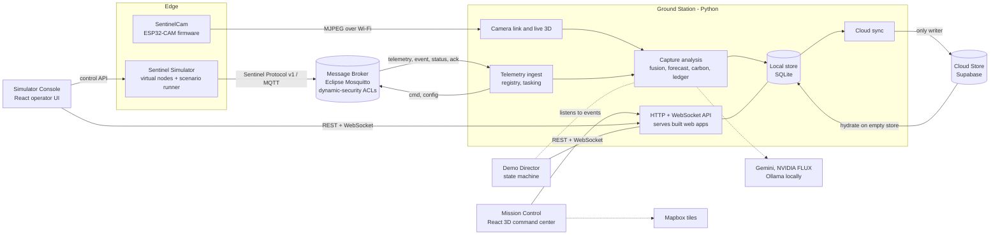

# Architecture

Blue Carbon Sentinel has seven runtime components (product spec section 1). The Ground Station is
the single brain and single writer; everything else talks to it or through the broker.

## Components

| Component | Role |
|---|---|
| SentinelCam | Live MJPEG stream, status, control and OTA over Wi-Fi. |
| Ground Station | Single brain and single writer: camera link, capture analysis, telemetry ingest, registry, tasking, fusion and risk, forecast, carbon and ledger, local store with cloud sync, HTTP and WebSocket API, serving the built web apps. |
| Sentinel Simulator | Runs the virtual Sentinel Nodes, each an independent MQTT client with its own credentials, plus the headless scenario runner. |
| Message Broker | Eclipse Mosquitto (native install, no Docker) carrying the Sentinel Protocol, with per-node credentials and ACLs. |
| Mission Control | React 3D command center; talks only to the Ground Station. |
| Simulator Console | React operator UI for the Simulator; reads the live image and node registry from the Ground Station. |
| Cloud Store | Supabase Postgres, Storage and Realtime; written only by the Ground Station. |

## Data flows

- **Camera:** SentinelCam to Ground Station (rectification, depth, height map) to Mission Control over
  WebSocket; periodic captures are classified, flagged, tasked, stored and synced.
- **Sensors:** simulator nodes to the broker to telemetry ingest (validate, dedupe, order), then store,
  live events, fusion and risk, and tasking commands back to nodes over MQTT.
- **Forecast and ledger:** operator action drives the forecast engine and future renderer; the applied
  plan and forecast feed the hash-chained ledger and evidence packs.

The message contract is documented in [protocol/sentinel-protocol-v1.md](protocol/sentinel-protocol-v1.md).
## Cross-cutting behaviour

- **Single writer.** Only the Ground Station writes to the Cloud Store. It allocates ledger indices locally,
  so the chain stays valid offline; writes queue in an outbox (the "Buffering offline (n queued)" badge) and
  drain when the cloud returns. An empty local store hydrates from the cloud at start (`bcs-gs hydrate`).
- **AI gateway.** Each AI role has a fallback chain in `config/ai.yaml` (Gemini primary, Gemini secondary,
  local Gemma via Ollama, rules). Every attempt is logged in `ai_calls` and exported as JSONL from
  `GET /api/v1/ai/calls/export`. Code computes every number; the AI returns bounded multipliers, parameters and
  narrative, and the rules tier always answers.
- **Seams.** Replaceable interfaces: `AIProvider` (`bcs_gs/ai/providers/base.py`), `ImagerySource` and
  `SiteRaster` (`bcs_gs/camera/imagery.py`), `CloudTarget`, `Clock`, and the Sentinel Protocol itself for
  nodes. See [swap-guide.md](swap-guide.md).
- **Demo Director.** A server-side state machine (`bcs_gs/director`) that advances only on real events
  (detect, task, measure, fuse, predict, restore, verify, plus an optional early-warning branch). It never
  fabricates an event; a step needing live captures shows "Camera offline" when the camera is down.
- **Preflight and performance.** `bcs_gs/status` runs the eleven preflight checks and the performance probe
  (`bcs-gs perf`) that compares measurements with the design section 33 targets.
- **Security.** Secrets live only in the gitignored `.env`; the API binds to localhost; the broker needs
  per-node credentials and ACLs; the Cloud Store uses RLS with an append-only ledger trigger.
